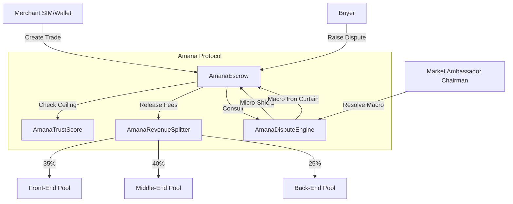

# Amana Protocol - Deployment Summary

## Network Details
- **Network Name**: Base Sepolia
- **Chain ID**: 84532
- **Currency**: ETH

## Deployed Contracts (Testnet Simulation)
The following addresses were generated during a local simulation of the deployment script. For actual production deployment, these addresses will change.

| Contract | Address |
|---|---|
| **AmanaTrustScore** | `0x5FbDB2315678afecb367f032d93F642f64180aa3` |
| **AmanaRevenueSplitter** | `0xe7f1725E7734CE288F8367e1Bb143E90bb3F0512` |
| **AmanaEscrow** | `0x9fE46736679d2D9a65F0992F2272dE9f3c7fa6e0` |
| **AmanaDisputeEngine** | `0xCf7Ed3AccA5a467e9e704C703E8D87F634fB0Fc9` |

## Deployment Procedure
The contracts are deployed using Foundry. The deployment script is located at `script/DeployAll.s.sol`.

### Prerequisites
1. Install Foundry: `curl -L https://foundry.paradigm.xyz | bash`
2. Set up environment variables:
   ```bash
   export PRIVATE_KEY=your_private_key
   export FRONT_END_POOL=0x...
   export MIDDLE_END_POOL=0x...
   export BACK_END_POOL=0x...
   export AMBASSADOR=0x...
   ```

### Execution
To deploy to Base Sepolia:
```bash
forge script script/DeployAll.s.sol --rpc-url https://sepolia.base.org --broadcast --verify
```

## Network Architecture


## Post-Deployment Configuration
- The `AmanaEscrow` contract is automatically linked to the `AmanaDisputeEngine` during the deployment process via `setDisputeEngine()`.
- Revenue pools and Market Ambassador Chairman can be updated by the owner (deployer) if necessary.
